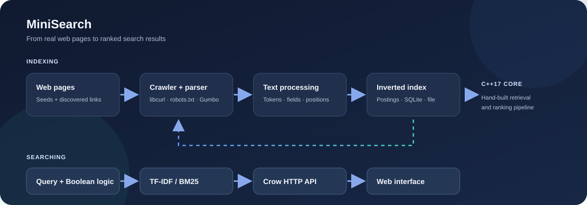

# MiniSearch

A miniature, fully working web search engine built **from scratch** in C++17:
a polite web crawler, Gumbo-based HTML extraction, a hand-written
text-processing pipeline, a hand-built inverted index, TF-IDF and BM25
ranking, Boolean + exact-phrase query processing, SQLite-backed
persistence with a serialized binary index, an HTTP API, and a clean web
front-end — all wired together so that **every search result comes from
documents this engine actually crawled, parsed, indexed and ranked**.

**Ground rules this project holds itself to (and how you can check them):**

- The inverted index, TF-IDF, BM25, and query processing are hand-written
  C++ — no Elasticsearch/Solr/Meilisearch/Typesense, no third-party
  retrieval or ranking library anywhere in the engine.
- External libraries are used only where the spec allows: **libcurl**
  (networking), **Gumbo** (HTML5 parsing), **nlohmann/json** (JSON),
  **SQLite** (document storage), **Crow** (HTTP framework), vanilla
  HTML/CSS/JS (front-end).
- No hardcoded results, no fake statistics: the analytics page reads live
  engine counters; the benchmark command measures on your machine.
- Not-implemented things are documented as such (see *Known limitations*).

<p align="center">
  
</p>

<p align="center">
  
</p>

## What it does

MiniSearch crawls pages, extracts and indexes their content, then serves
search results from that index through a C++ HTTP API and browser UI. The
crawler can also index the included documentation corpus served locally by
the app.

---

## Quick start

```bash
cmake -S . -B build -DCMAKE_BUILD_TYPE=Release   # downloads deps once
cmake --build build -j

./build/minisearch serve                          # http://localhost:8080
```

Then open <http://localhost:8080> and start a crawl from the
**Crawler** page. To crawl the included sample corpus from a terminal,
leave the server running and use a second terminal:

```bash
# The server hosts a 22-page documentation corpus as its own site on
# port 8081 (with robots.txt). Crawl it through the engine itself:
./build/minisearch crawl --seeds http://localhost:8081/ --max-depth 3 --delay-ms 50

# Search the newly indexed corpus:
./build/minisearch search "c++ programming"
./build/minisearch search "\"competitive programming\""
./build/minisearch search "inverted AND index"
```

The database and index are runtime data and are not committed to Git. On a
fresh clone, crawl the sample corpus before searching; `wipe` clears the
local index.

## Features

| Capability | Where | Notes |
|---|---|---|
| Web crawler | `src/crawler/` | BFS frontier, depth/page budgets, per-host politeness, robots.txt (RFC 9309 subset), allowed domains, login/admin avoidance, redirect dedup, size caps |
| HTML parsing | `src/parser/` | Gumbo tree walk: title, meta description, canonical, h1/h2, links, visible text; script/style/nav/aside/footer removed |
| Text processing | `src/processor/` | protected technical terms (`C++→cpp`, `Node.js→nodejs`), light stemmer, stop-word policy, per-field positions |
| Inverted index | `src/index/` | hand-built posting lists (sorted by doc id), per-field tf, positions with field-boundary gaps |
| TF-IDF / BM25 | `src/ranking/` | both hand-written, selectable per query, field boosts 3/2/1 and k1/b configurable |
| Query language | `src/query/` | AND / OR / NOT, `"exact phrases"`, parentheses, implicit AND; recursive-descent parser, two-pointer set ops |
| Persistence | `src/storage/` | SQLite metadata (stable ids, upsert by URL) + atomic binary index (varint + delta encoding), corruption detection, incremental startup reconciliation |
| HTTP API | `src/api/` | Crow; see below |
| Web UI | `frontend/` | home, results, analytics, crawler console — all live data |
| Tests | `tests/` | 138 unit tests + 12 integration tests (real HTTP) |
| Benchmarks | `minisearch benchmark` | brute force vs inverted index, measured live |

## Architecture

The engine is a static library (`minisearch_core`) with **no HTTP and no UI
knowledge**. The CLI and the Crow API are thin front-ends over the same
`SearchEngine` facade — which is why the web UI can never display anything
the engine did not produce.

```
WEBSITES ──► WebCrawler ──► HTMLParser ──► TextProcessor ──► InvertedIndex
             (libcurl,      (Gumbo)        (tokens, terms)      │
              robots.txt,                                        ├─► StorageManager
              politeness)                                        │    (SQLite + binary
                                                                  │     index file)
                                                                  ▼
                                              QueryProcessor ──► TFIDF / BM25
                                              (AST, two-pointer     │
                                               merges, phrases)      ▼
                                                              SearchAPI (Crow)
                                                                    │ JSON
                                                                    ▼
                                                                Web UI (vanilla JS)
```

Full module inventory, data contracts, threading model and design
rationale: [docs/architecture.md](docs/architecture.md).
Exact rules (tokenizer table, stemmer table, ranking formulas, query
grammar, index file format): [docs/algorithms.md](docs/algorithms.md).

## Technology stack

| Layer | Choice |
|---|---|
| Core engine | C++17, STL, CMake ≥ 3.16 |
| Networking | libcurl |
| HTML parsing | Gumbo (vendored at configure time) |
| JSON | nlohmann/json single header (downloaded at configure time) |
| Storage | SQLite 3 + custom binary posting format |
| HTTP framework | Crow (header-only, system Boost.Asio) |
| Front-end | HTML5 / CSS3 / vanilla JavaScript |
| Tests | built-in GoogleTest-style harness (`tests/test_framework.h`) |

## Building

Requirements: a C++17 compiler, CMake ≥ 3.16, libcurl, SQLite 3, and
Boost headers. The release zip additionally ships `vendor/` with the three
remaining dependencies (gumbo, nlohmann/json, Crow) pre-extracted, so **the
zip builds fully offline**. A plain git checkout has no `vendor/` and
downloads those archives once at configure time into `build/deps/`.

```bash
sudo apt install build-essential cmake libcurl4-openssl-dev \
                   libsqlite3-dev libboost-dev        # Debian/Ubuntu
cmake -S . -B build -DCMAKE_BUILD_TYPE=Release
cmake --build build -j
```

**Offline machines (git checkout):** create `build/deps/` yourself with
`include/nlohmann/json.hpp` (from the nlohmann/json v3.11.3 release),
`gumbo-parser-master/` (extracted from the GitHub master tarball), and
`Crow-master/` (extracted from the CrowCpp/Crow master tarball), or copy the
`vendor/` tree from the release zip. The CMake error messages name the exact
URLs.

Artifacts: `build/minisearch` (CLI + server), `build/minisearch_tests`,
`build/minisearch_integration_tests`, `build/libminisearch_core.a`.

### Windows with MinGW (MSYS2 UCRT64)

Open the **MSYS2 UCRT64** terminal and install the compiler and libraries:

```bash
pacman -S --needed mingw-w64-ucrt-x86_64-gcc \
  mingw-w64-ucrt-x86_64-cmake mingw-w64-ucrt-x86_64-make \
  mingw-w64-ucrt-x86_64-boost mingw-w64-ucrt-x86_64-sqlite3 \
  mingw-w64-ucrt-x86_64-curl
```

From that terminal, configure and build (use your own project directory if
it is not under the path below):

```bash
cd /c/Users/moham/OneDrive/Desktop/MiniSearch-complete
cmake -G "MinGW Makefiles" -S . -B build -DCMAKE_BUILD_TYPE=Release
cmake --build build --parallel
```

The executable is `build/minisearch.exe`. Run it from the project root so
the default config and frontend paths resolve:

```bash
./build/minisearch.exe serve
```

Then open <http://localhost:8080>. Press `Ctrl+C` in the terminal to stop
the server. The corpus test site is served on port `8081`.

## Running

```
minisearch serve [--port N] [--host H]        HTTP API + web UI + corpus site
minisearch crawl  --seeds URL[,URL..]         crawl + index (blocking, live progress)
minisearch search "QUERY" [--algo tfidf|bm25] [--limit N] [--offset N] [--json]
minisearch stats [--json]                     live index statistics
minisearch doc ID                             stored document record
minisearch reindex                            rebuild the index from SQLite
minisearch benchmark [--runs N] [--scale N]   brute force vs inverted index
minisearch wipe [--yes]                       delete all indexed documents
minisearch demo | tokenize                    text-pipeline inspection tools
```

The server occupies **two** ports: the app on `--port` (default 8080) and
the seed corpus as its own site on port+1 (default 8081) — the corpus
site has its own `robots.txt`, so crawler compliance is genuinely
exercised when you crawl `http://localhost:8081/`.

## Example searches

```
c++ programming              keyword search (technical terms preserved)
"competitive programming"    exact phrase (order + adjacency verified)
inverted AND index           Boolean intersection
python OR sql                Boolean union
index NOT sql                exclusion
(inverted OR boolean) AND index   grouping
```

## Query syntax

```
expr    := or_expr
or_expr := and_expr ( OR and_expr )*
and_expr := not_expr ( [AND] not_expr )*     // adjacent terms imply AND
not_expr := primary ( NOT primary )*
primary := '(' expr ')' | '"' phrase '"' | TERM
```

Operators are case-insensitive; phrases keep stop words (`"state of the
art"` matches the real four-word sequence). Syntax errors are reported,
never silently ignored.

## API

| Endpoint | Purpose |
|---|---|
| `GET /api/search?q=&algorithm=tfidf\|bm25&limit=&offset=` | ranked results: id, title, url, snippet, score, matched terms, total, took_ms |
| `GET /api/suggest?q=prefix` | term completions with document counts |
| `GET /api/stats` | documents, unique terms, postings, index size, avg doc length, avg search latency, crawl counters, last indexing time, top terms |
| `GET /api/document/{id}` | full stored document (content capped at 20 KB) |
| `POST /api/crawl` | body: `{"seeds":[url..],"max_depth":0..5,"max_pages":1..500,"delay_ms":0..10000,"allowed_domains":[..]}` |
| `GET /api/crawl/status` | live job progress, counters and the last 50 crawl-log entries |

```bash
curl "http://localhost:8080/api/search?q=c%2B%2B%20programming&algorithm=bm25&limit=3"
curl -X POST http://localhost:8080/api/crawl \
     -H "Content-Type: application/json" \
     -d '{"seeds":["http://localhost:8081/"],"max_depth":3,"max_pages":30}'
```

Errors: `400` invalid input (missing q, bad algorithm, malformed JSON,
invalid seeds, query syntax), `404` unknown document/route, `409` crawl
already running, `500` generic internal error (no internals leaked).

## Testing

```bash
cd build && ctest --output-on-failure
# Test #1: unit_tests         - 138 tests (document/text/index/ranking/
#                                query/persistence/parser/url/robots/crawler)
# Test #2: integration_tests  - 12 tests: boots the real Crow server,
#                                crawls the corpus over HTTP, verifies
#                                robots compliance, all query types, both
#                                algorithms, suggestions, stats, documents,
#                                error codes, and persistence restart.
```

The harness (`tests/test_framework.h`) mirrors the GoogleTest macro
interface; migrating suites later is mechanical. It is kept dependency-
free deliberately — see `docs/architecture.md` §testing for the rationale.

## Benchmarks

```bash
./build/minisearch benchmark --runs 25 --scale 500 --markdown docs/benchmarks.md
```

Compares (A) the full engine search path (retrieval + BM25 + snippets +
SQLite reads) and (B) the retrieval core at scale — the real corpus
replicated in memory — inverted index vs brute-force document scanning on
identical data and queries. On the reference machine: **4.46× mean
speedup at 10,500 documents** on a distribution that is worst-case for
the index (replication puts common terms in *every* document, so posting
lists are maximally long). Full numbers and methodology:
[docs/benchmarks.md](docs/benchmarks.md).

## The inverted index in one paragraph

Every term maps to a sorted posting list; each posting records the
document id, per-field term frequencies (title / heading / body) and the
term's positions in a *virtual position stream* that spans the document's
title, headings and body with deliberate gaps at the boundaries. Sorted
lists make Boolean operations two-pointer merges; stored positions make
phrase verification possible; the boundary gaps make phrase matches
field-correct (a phrase can never match across a title/body edge).
Details and complexity: [docs/algorithms.md](docs/algorithms.md).

## Repository layout

```
MiniSearch/
├── CMakeLists.txt          config/config.json      .gitignore
├── data/                   # runtime storage (db + index file); contents gitignored
├── include/  + src/        # one directory per module:
│   ├── common/             #   Document, EngineConfig
│   ├── processor/          #   TextProcessor
│   ├── index/              #   InvertedIndex
│   ├── ranking/            #   Ranker, TFIDF, BM25
│   ├── query/              #   QueryParser, QueryProcessor
│   ├── storage/            #   StorageManager (SQLite + binary index)
│   ├── parser/             #   HTMLParser (Gumbo)
│   ├── crawler/            #   Url, RobotsTxt, HttpDownloader, WebCrawler
│   ├── engine/             #   SearchEngine facade
│   ├── api/                #   SearchAPI (Crow)
│   ├── benchmark/          #   Benchmark harness
│   └── main.cpp            # CLI front-end
├── frontend/               # index/search/analytics/crawler + css/js/assets
├── tools/                  # generate_corpus.py + the 22-page seed corpus
├── tests/                  # unit + integration suites + harness
├── docs/                   # architecture.md, algorithms.md, benchmarks.md, images/
└── vendor/                 # zip only: gumbo + crow + nlohmann/json, offline build
```

## Known limitations

- **ASCII tokenization.** Non-ASCII bytes act as separators (`café → caf`);
  pinned by a test; ICU/UTF-8 is future work.
- **Light stemmer quirks.** `series → sery`, `heroes → heroe`,
  `control/controlled` don't unify. Documented in `docs/algorithms.md`;
  a Snowball/Porter stemmer is future work.
- **robots.txt subset.** No `Sitemap:` handling, no wildcards (`*`/`$`) in
  paths, unreachable robots = allow-all per RFC 9309 defaults.
- **Crawl-delay** is honored as a *minimum* delay (max of config and
  robots value), not re-scheduled dynamically.
- **One crawl job at a time** (a second request gets `409`).
- **Duplicate content across different URLs** is not merged (canonical
  URLs are stored but not used for dedup) — listed under future work.
- **Searches take a shared lock; indexing briefly takes the exclusive
  lock** — a search during heavy indexing may pause for milliseconds.

## Future improvements (design room reserved, not implemented)

Semantic search & vector embeddings, cosine similarity, HNSW ANN, hybrid
keyword+semantic fusion, autocomplete beyond prefix terms, result
highlighting server-side, PageRank over the crawled link graph,
distributed crawling, duplicate-content detection via MinHash, Snowball
stemming, UTF-8/ICU tokenization.
